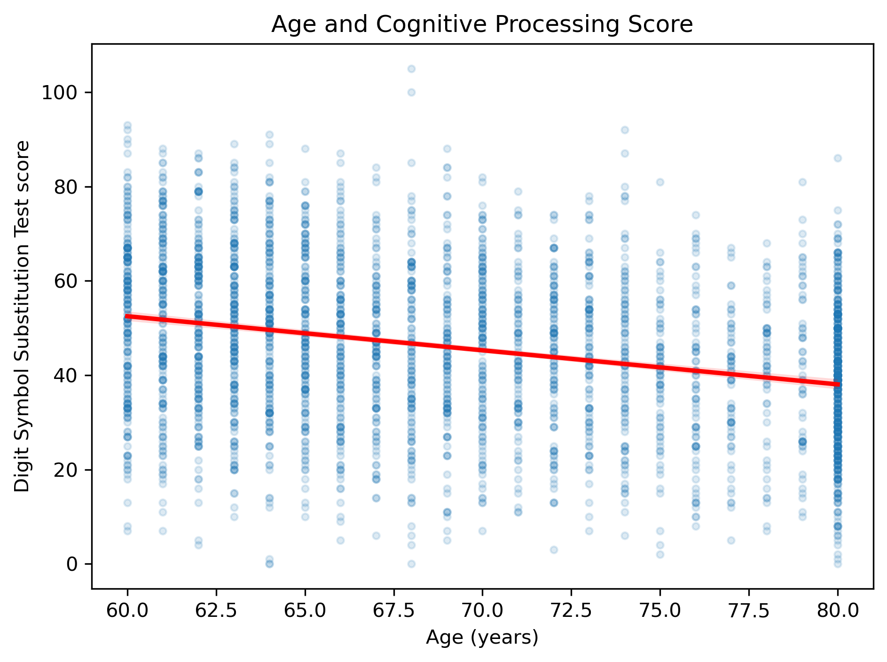
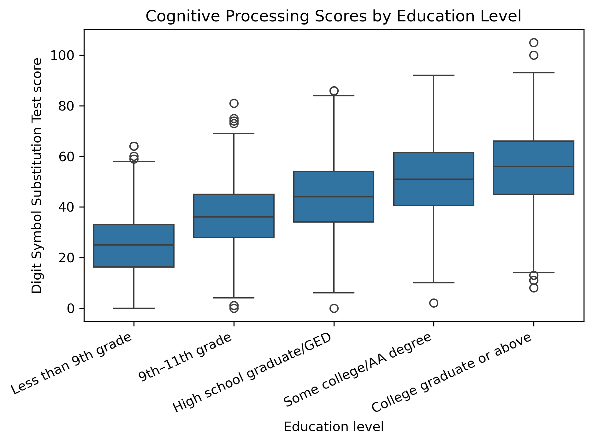
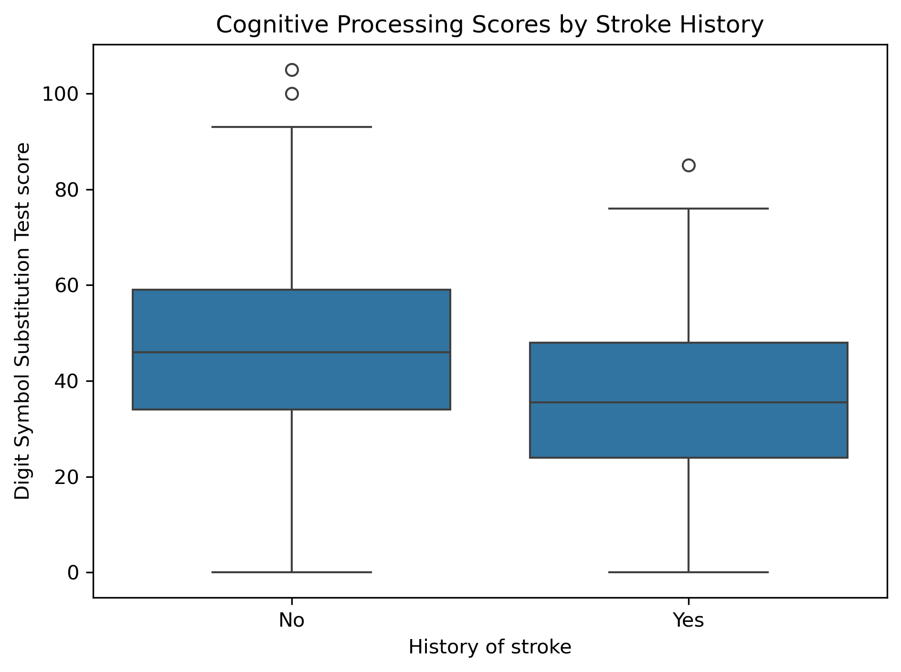

# Factors Associated with Cognitive Processing Speed Among U.S. Adults Aged 60 and Older

**NHANES 2011–2014 | Survey-weighted regression analysis**

## Project Overview

This project investigates factors associated with cognitive processing speed among U.S. adults aged 60 and older using data from the National Health and Nutrition Examination Survey (NHANES), 2011–2014.

The analysis examines associations between Digit Symbol Substitution Test (DSST) performance and age, sex, educational attainment, history of stroke, and depressive symptoms.

## Research Question

How are age, sex, education, stroke history, and depressive symptoms associated with cognitive processing performance among U.S. adults aged 60 and older?

## Data Sources

The analysis combines data from two NHANES survey cycles:

- [NHANES 2011–2012: Cognitive Functioning (CFQ_G)](https://wwwn.cdc.gov/Nchs/Data/Nhanes/Public/2011/DataFiles/CFQ_G.htm)
- [NHANES 2013–2014: Cognitive Functioning (CFQ_H)](https://wwwn.cdc.gov/Nchs/Data/Nhanes/Public/2013/DataFiles/CFQ_H.htm)

Additional NHANES datasets provide demographic information, medical history, and depression questionnaire responses.

| Dataset | 2011–2012 | 2013–2014 | Purpose |
|---|---|---|---|
| Cognitive functioning | `CFQ_G.xpt` | `CFQ_H.xpt` | Cognitive test scores |
| Demographics | `DEMO_G.xpt` | `DEMO_H.xpt` | Age, sex, education, survey design |
| Medical conditions | `MCQ_G.xpt` | `MCQ_H.xpt` | Stroke history |
| Depression questionnaire | `DPQ_G.xpt` | `DPQ_H.xpt` | PHQ-9 score |

The datasets are publicly available from the U.S. Centers for Disease Control and Prevention (CDC). Download the required files and place them in the notebook's working directory before running the analysis.

**Study population:** U.S. adults aged 60 and older  
**Survey period:** 2011–2014  
**Final analytical sample:** 2,936 participants

## Variables

### Outcome

- `CFDDS`: Digit Symbol Substitution Test (DSST) score, used as a measure of performance on a cognitive processing task.

### Explanatory variables

- Age in years
- Sex
- Educational attainment
- Self-reported history of stroke
- Depressive symptoms measured using the Patient Health Questionnaire-9 (PHQ-9)

The primary model uses female participants, participants with 9th–11th grade education, and participants without a history of stroke as reference categories.

## Methods

The analysis includes:

1. Combining the 2011–2012 and 2013–2014 survey cycles.
2. Data preparation, quality checks, and missing-data assessment.
3. Construction of the PHQ-9 score, requiring all nine questionnaire items to be valid.
4. Exploratory analysis and descriptive visualizations.
5. Survey-weighted linear regression accounting for NHANES weights, strata, and primary sampling units.
6. A supplementary age-by-education interaction model.
7. OLS-based residual, influence, and multicollinearity diagnostics.
8. Cross-checking the primary regression estimates using R's `survey` package.

The four-year examination weight was calculated as `WTMEC2YR / 2`. Both regression models use the same complete-case sample of 2,936 participants.

## Results: Primary Model

The primary survey-weighted linear regression examined the adjusted associations between the explanatory variables and DSST scores.

| Variable | Coefficient | 95% Confidence Interval | p-value |
|---|---:|---:|---:|
| Age (years) | −0.904 | −0.996 to −0.811 | <0.001 |
| Male vs. female | −5.293 | −6.265 to −4.320 | <0.001 |
| College graduate or above | +16.462 | 14.180 to 18.744 | <0.001 |
| High school graduate/GED | +6.640 | 5.023 to 8.257 | <0.001 |
| Less than 9th grade | −11.348 | −14.155 to −8.541 | <0.001 |
| Some college or associate degree | +12.065 | 10.253 to 13.878 | <0.001 |
| History of stroke: yes vs. no | −5.419 | −7.666 to −3.172 | <0.001 |
| PHQ-9 score | −0.611 | −0.807 to −0.416 | <0.001 |

Education coefficients are relative to the 9th–11th grade reference category. All coefficients are adjusted for the other variables in the model.

### Interpretation

- **Age:** Each additional year of age was associated with an estimated 0.90-point lower DSST score.
- **Sex:** Male participants had scores approximately 5.29 points lower than female participants.
- **Education:** Participants with higher educational attainment generally had higher scores relative to the 9th–11th grade reference group. Participants with less than 9th grade education had lower scores.
- **Stroke history:** Participants reporting a history of stroke had scores approximately 5.42 points lower than those reporting no history of stroke.
- **Depressive symptoms:** Each additional PHQ-9 point was associated with an estimated 0.61-point lower DSST score.

All explanatory variables in the primary model were statistically associated with the outcome at p < 0.001.

## Descriptive Results

The following plots show differences in cognitive processing test scores across age, education, and stroke-history groups. They are unweighted descriptive analyses; the regression models account for the NHANES survey design.

### Cognitive Processing Scores by Age

Scores tended to be lower in older age groups.

### Cognitive Processing Scores by Education

Mean scores differed across education groups, with higher scores observed among participants with higher educational attainment.

### Cognitive Processing Scores by Stroke History

Participants reporting a history of stroke had lower mean scores than participants reporting no history of stroke.

## Supplementary Analysis: Age-by-Education Interaction

A supplementary survey-weighted model examined whether the association between age and DSST performance differed across education groups.

| Interaction term | Coefficient | 95% Confidence Interval | p-value |
|---|---:|---:|---:|
| Age × college graduate or above | −0.348 | −0.687 to −0.008 | 0.045 |
| Age × high school graduate/GED | −0.035 | −0.381 to 0.312 | 0.836 |
| Age × less than 9th grade | +0.181 | −0.254 to 0.616 | 0.396 |
| Age × some college or associate degree | −0.368 | −0.697 to −0.038 | 0.030 |

A joint Wald test indicated that the interaction terms were statistically significant overall: **F(4, 20) = 5.319, p = 0.0044**.

The negative interaction coefficients for college graduates and participants with some college or an associate degree indicate a more negative age association relative to the 9th–11th grade reference group.

Education main-effect coefficients in the interaction model represent differences at age zero under the model's parameterization. They should not be interpreted as meaningful education-group differences among adults aged 60 and older.

The primary model remains the main analysis because it is simpler to interpret. The interaction model is presented as a supplementary analysis.

## Model Checks

OLS diagnostics were conducted as supplementary checks using a model with the same main-effect predictors.

- Predictor VIF values ranged from 1.02 to 2.18, excluding the intercept, indicating no evidence of serious multicollinearity in the primary OLS model.
- Residual and Q–Q plots were examined to assess potential departures from model assumptions.
- Standardized residuals and Cook's distance were examined for unusual or influential observations.

These diagnostics are based on OLS and do not fully validate residual behavior in the survey-weighted models.

## Descriptive Visualizations

The repository includes three unweighted exploratory plots:

- `stroke_history_score.png` — DSST scores by stroke history
- `age_cognitive_score.png` — DSST scores by age
- `education_level_score.png` — DSST scores by education level

These plots are descriptive and unweighted. The regression models account for the complex NHANES survey design.

## Limitations

- **Cross-sectional design:** The analysis cannot establish causal relationships or measure within-person cognitive decline over time.
- **Outcome measurement:** DSST measures performance on a specific cognitive task. It is not a comprehensive assessment of cognition or a diagnosis of dementia.
- **Complete-case analysis:** Participants with missing data on required model variables were excluded, potentially introducing selection bias.
- **Residual confounding:** Other factors associated with cognitive performance may not be accounted for.
- **Model assumptions:** The primary model assumes a linear association between age and the outcome. The supplementary model examines whether this association varies by education group.
- **Descriptive visualizations:** The plots are unweighted, whereas the regression models account for the NHANES survey design.
- **Generalizability:** Findings reflect older U.S. adults surveyed in 2011–2014 and may not generalize to other populations or periods.

## Tools and Technologies

- Python
- pandas and NumPy
- Polars
- SciPy
- statsmodels
- matplotlib and seaborn
- `svy` for survey-weighted regression
- R and the `survey` package for cross-checking the primary model

## Project Files

- `nhanes_cognitive_processing_analysis.ipynb` — data preparation, exploratory analysis, regression models, diagnostics, and interpretation
- `age_cognitive_score.png`
- `education_level_score.png`
- `stroke_history_score.png`

The raw NHANES files are required to reproduce the analysis and are not included in the repository.

## Reproducibility

1. Download the eight NHANES `.xpt` files listed in the Data Sources section.
2. Place the files in the notebook's working directory, or update the file paths.
3. Install the Python packages imported by the notebook.
4. Run the notebook from beginning to end.
5. To reproduce the optional R cross-check, install R and the `survey` package and ensure R is available on the system path.

## Conclusion

In this analysis of NHANES 2011–2014 data, age, sex, educational attainment, stroke history, and depressive symptoms were associated with DSST performance among U.S. adults aged 60 and older.

The supplementary analysis found evidence that the age association varied across some education groups. These findings describe adjusted cross-sectional associations and should not be interpreted as causal effects or evidence of individual cognitive decline.
